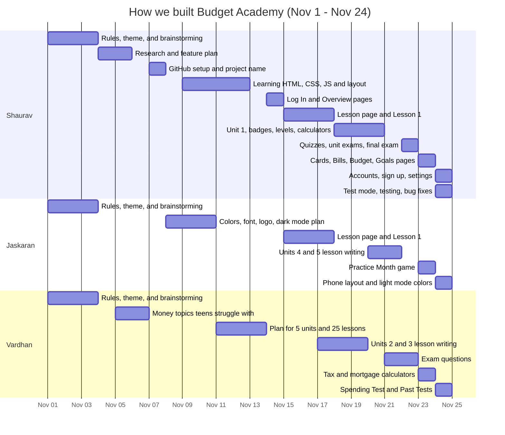

# Budget Academy

A budgeting website that helps people learn, practice, and master managing their money.

Made by Shaurav Kasinaboyina, Jaskaran Kalsi, and Vardhan Devata for the TSA Software Development event.

## Timeline

| Date | Who | What we did |
|---|---|---|
| Nov 1 - 3 | Shaurav, Jaskaran, Vardhan | Read the TSA rules and this year's theme, brainstormed ideas, and picked a budgeting app. |
| Nov 4 - 5 | Shaurav | Looked at money apps and learning sites, then planned the main parts: Learn Mode, My Money, and tests. |
| Nov 5 - 6 | Vardhan | Made a list of the money topics teens struggle with most, to decide what the lessons should cover. |
| Nov 7 | Shaurav | Set up the GitHub repo and named the project Budget Academy. |
| Nov 8 - 10 | Jaskaran | Picked the colors, the Nunito font, and the logo, and planned dark and light mode. |
| Nov 9 - 12 | Shaurav | Learned HTML, CSS, and JavaScript basics and built the page layout and sidebar. |
| Nov 11 - 13 | Vardhan | Planned the 5 units and 25 lessons, and the story of Jordan that runs through them. |
| Nov 14 | Shaurav | Built the Log In page and the Overview home page, and put the first version on GitHub. |
| Nov 15 - 17 | Shaurav, Jaskaran | Built the lesson page that shows one step at a time, plus Lesson 1 and its quiz. |
| Nov 17 - 19 | Vardhan | Wrote the lessons for Unit 2 (Banking and Saving) and Unit 3 (Credit and Debt). |
| Nov 18 - 20 | Shaurav | Finished Unit 1 and added badges, skill levels, and the money calculators. |
| Nov 20 - 21 | Jaskaran | Wrote the lessons for Unit 4 (Bills, Taxes, and Growing Up) and Unit 5 (Investing). |
| Nov 21 - 22 | Vardhan | Wrote the questions for the lesson quizzes and unit exams. |
| Nov 22 | Shaurav | Added all 25 lessons, the quizzes, the 5 unit exams, the final exam, and locked exam popups. |
| Nov 23 | Shaurav | Built the Cards, Bills, Budget, and Goals pages. |
| Nov 23 | Jaskaran | Built the Practice Month game with surprise events and a score. |
| Nov 23 | Vardhan | Built the tax and mortgage calculators and tested the money pages. |
| Nov 24 | Shaurav | Added real accounts with sign up and log in, and the Settings page. |
| Nov 24 | Jaskaran | Made the site work on phones and softened the light mode colors. |
| Nov 24 | Vardhan | Built the Spending Test questions and the Past Tests page with a score chart. |
| Nov 24 | Shaurav | Added test mode, tested everything on a computer and a phone, and fixed bugs. |
